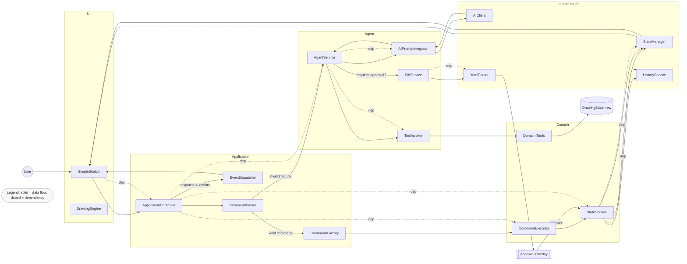

# Architecture Now — 現状アーキテクチャ概要（Clean Architecture 観点）

本書はリポジトリ実装を走査して得た「現状」の依存関係とデータフローを、Clean Architecture の観点で整理したものです。修正提案ではなく、実装実態の見取り図です。

## Mermaid（レイヤと依存関係）

```mermaid
flowchart TB
  %% レイヤ分割
  subgraph UI[Presentation / UI]
    SimpleSketch[SimpleSketch]
    DrawingEngine[engine.DrawingEngine]
  end

  subgraph APP[Application]
    AppCtrl[application.ApplicationController]
    CmdParser[application.CommandParser]
    CmdFactory[application.CommandFactory]
    EvtDispatcher[events.EventDispatcher]
  end

  subgraph DOMAIN[Domain]
    DModels[domain.models / values]
    DCmds[domain.commands]
    DServices[domain.services (StateService, CommandExecutor)]
    DTools[domain.tools (ToolRegistry, IAgentTool, impl/*)]
  end

  subgraph AGENT[Agent]
    AgentService[agent.service.AgentService]
    PromptIntegrator[agent.prompt.AIPromptIntegrator]
    ToolInvoker[agent.service.ToolInvoker]
    DiffService[agent.diff.DiffService]
    GetStateTool[agent.tools.impl.GetStateTool]
    UndoRedoTool[agent.tools.impl.UndoRedoTool]
  end

  subgraph INFRA[Infrastructure / Services]
    StateManager[services.StateManager]
    HistoryService[services.HistoryService]
    SessionManager[services.SessionManager]
    FileRepo[services.FileStateRepository]
    AIClient[infrastructure.ai.AIClient]
    YamlParser[engine.YamlParser]
  end

  %% 依存関係（点線）
  SimpleSketch -.-> AppCtrl
  SimpleSketch -.-> DrawingEngine

  AppCtrl -.-> CmdParser
  AppCtrl -.-> CmdFactory
  AppCtrl -.-> EvtDispatcher
  AppCtrl -.-> DServices
  AppCtrl -.-> SessionManager
  AppCtrl -.-> FileRepo
  AppCtrl -.-> AgentService
  AppCtrl -.-> DiffService

  AgentService -.-> PromptIntegrator
  AgentService -.-> ToolInvoker
  PromptIntegrator -.-> AIClient
  ToolInvoker -.-> DTools
  DTools -.-> DModels

  DServices -. cross-layer .-> StateManager
  DServices -. cross-layer .-> HistoryService
  SessionManager -.-> StateManager
  SessionManager -.-> HistoryService
  SessionManager -.-> FileRepo
  DiffService -.-> YamlParser

  %% 凡例
  classDef note fill:#f8f8f8,stroke:#bbb,color:#333;
  Note1([Legend: dotted = dependency (compile-time), solid = data flow (runtime)]):::note
```

## Mermaid（依存＋データフロー統合図）



## Mermaid（コンポーネント構成図：依存＋フロー同梱）

```mermaid
flowchart TB
  %% Presentation
  subgraph P[Presentation]
    DCV[DrawingCanvas]
    CHP[ChatPanel]
    APR[ApprovalPanel]
    EVH[EventHandler (EventDispatcher)]
    DRE[engine.DrawingEngine]
  end

  %% Application
  subgraph A[Application]
    ACT[ApplicationController]
    SESM[services.SessionManager]
  end

  %% Agent
  subgraph G[Agent]
    AGS[AgentService (Orchestrator)]
    PRI[AIPromptIntegrator]
    TIV[ToolInvoker]
    DFS[DiffService]
  end

  %% Domain
  subgraph D[Domain]
    DSS[StateService]
    DCE[CommandExecutor]
    DTO[Domain Tools (ToolRegistry, Tools*)]
  end

  %% Infrastructure
  subgraph I[Infrastructure]
    AICF[AIClient]
    STR[FileStateRepository]
    STM[StateManager]
    HSR[HistoryService]
    YPR[YamlParser]
  end

  %% Data Flows (solid)
  CHP --> EVH --> ACT
  DCV --> EVH
  APR --> EVH --> ACT

  %% Application orchestrations
  ACT -->|parse/command| DCE --> DSS --> STM --> DCV
  ACT -->|session ops| SESM --> STR
  ACT -->|AI request| AGS
  AGS --> PRI --> AICF --> PRI --> AGS
  AGS --> TIV --> DTO --> DSS
  AGS -->|approval request| DFS --> YPR --> APR

  %% Dependencies (dotted)
  CHP -.dep.-> EVH
  DCV -.dep.-> DRE
  EVH -.dep.-> ACT
  ACT -.dep.-> DCE
  ACT -.dep.-> DSS
  ACT -.dep.-> SESM
  SESM -.dep.-> STR
  DSS -.dep.-> STM
  DSS -.dep.-> HSR
  AGS -.dep.-> PRI
  AGS -.dep.-> TIV
  PRI -.dep.-> AICF
  TIV -.dep.-> DTO
  DFS -.dep.-> YPR

  %% Legend
  classDef legend fill:#f8f8f8,stroke:#bbb,color:#333;
  LEG([Legend: solid = data flow, dotted = dependency]):::legend
```

## ASCIIスタイル図（requirement/architecture.md 準拠 + 依存/フロー同梱）

以下は requirement/architecture.md のレイアウトを踏襲しつつ、依存（点線）とデータフロー（矢印）を同梱した現状図です。

```
┌──────────────────────────────────────────────────────────────────────────┐
│                              Presentation (UI)                            │
│ ┌──────────────┐  ┌─────────────┐  ┌───────────────────────┐             │
│ │ DrawingCanvas│  │  ChatPanel  │  │    ApprovalPanel      │             │
│ └───────┬──────┘  └──────┬──────┘  └───────────┬───────────┘             │
│         │                │                     │                           │
│         │ UI Events      │ UI Input            │ Approve/Reject            │
│         ▼                ▼                     ▼                           │
│                         EventHandler (EventDispatcher)                     │
└─────────┼──────────────────────────────┬───────────────────────────────────┘
          │ (data flow →)               │ (dependency -.->)
          ▼                              
┌──────────────────────────────────────────────────────────────────────────┐
│                          Application (Core Logic)                         │
│   ┌──────────────────────┐        ┌──────────────────┐                    │
│   │ ApplicationController│ -.->   │  CommandParser   │                    │
│   └───────────┬──────────┘        └───────┬──────────┘                    │
│               │                           │                                 │
│               │ parse                     │ parsed                          │
│               ▼                           ▼                                 │
│        ┌───────────────┐          ┌───────────────┐                         │
│        │ CommandFactory│ -.->     │ CommandExecutor│ → executes             │
│        └───────┬───────┘          └───────┬───────┘                         │
│                │                           │                                 │
│                │                           ▼                                 │
│                │                    StateService (domain) -.-> StateManager  │
│                │                               │             -.-> HistorySvc │
│                │                               ▼                             │
│                │                         DrawingState → UI Refresh           │
│                │
│                ├─→ SessionManager -.-> FileStateRepository → Filesystem      │
│                │
│                └─→ AgentService (AI) -.-> AIPromptIntegrator -.-> AIClient   │
│                                         └→ ToolInvoker -.-> DomainTools      │
│                                         └→ DiffService -.-> YamlParser       │
└──────────────────────────────────────────────────────────────────────────┘

データフロー（代表例）:
- ChatPanel → EventHandler → ApplicationController →
  - valid: CommandParser → CommandFactory → CommandExecutor → StateService → StateManager → UI
  - natural: AgentService → AIPromptIntegrator ⇄ AIClient → ToolInvoker → DomainTools → DrawingState
  - requiresApproval: DiffService → YamlParser → ApprovalPanel → (承認) StateService → UI

凡例: 実線の矢印 → はランタイムのデータ/制御フロー、点線 -.-> はコンパイル時の依存関係。
```

## レイヤ対応（Clean Architecture 対応づけ）

- Entities / Domain（中心）
  - `com.example.domain.models/*`, `com.example.domain.values/*`, `com.example.domain.commands/*`, `com.example.domain.session/*`
  - ツール定義: `com.example.domain.tools/*`（`IAgentTool`, `ToolRegistry`, 実装は `domain.tools.impl/*`）
- Use Cases（ユースケース/ドメインサービス）
  - `com.example.domain.services/*`（`StateService`, `CommandExecutor` など）
  - 備考: 現状 `domain.services` が `com.example.services.*`（`StateManager`, `HistoryService`）へ依存
- Interface Adapters（アダプタ/アプリ調停）
  - アプリ層: `com.example.application/*`（`ApplicationController`, `CommandParser`, `CommandFactory`）
  - エージェント層: `com.example.agent.service/*`, `com.example.agent.prompt/*`, `com.example.agent.tools.impl/*`, `com.example.agent.diff/*`
  - イベント: `com.example.events/*`
  - レンダリング/変換: `com.example.engine/*`（`DrawingEngine`, `YamlParser`）
- Frameworks & Drivers（外部I/O・詳細）
  - AI クライアント: `com.example.infrastructure.ai/*`
  - ストレージ/共通サービス: `com.example.services/*`（`FileStateRepository`, `SessionManager`, `StateManager`, `HistoryService`, `FileUtils`）
  - UI/Processing: `com.example.SimpleSketch`

参考実装箇所（抜粋）:
- `src/main/java/com/example/application/ApplicationController.java:1`
- `src/main/java/com/example/agent/service/AgentService.java:1`
- `src/main/java/com/example/domain/services/StateService.java:1`
- `src/main/java/com/example/services/SessionManager.java:1`
- `src/main/java/com/example/agent/diff/DiffService.java:1`
- `src/main/java/com/example/engine/YamlParser.java:1`

## 依存関係（矢印は「依存」方向 ->）

```
UI / Processing
  com.example.SimpleSketch
    -> com.example.application.ApplicationController
    -> com.example.engine.DrawingEngine
    -> com.example.events.*

Application 層
  com.example.application.ApplicationController
    -> com.example.domain.services.StateService
    -> com.example.domain.services.CommandExecutor
    -> com.example.application.CommandParser / CommandFactory
    -> com.example.services.SessionManager, FileStateRepository
    -> com.example.domain.tools.ToolInitializer
    -> com.example.agent.service.AgentService
    -> com.example.agent.diff.DiffService (← uses engine.YamlParser)
    -> com.example.events.*

Domain Services / Tools
  com.example.domain.services.StateService
    -> com.example.services.StateManager, HistoryService
    -> com.example.domain.model(s).DrawingSession / DrawingState

  com.example.domain.services.CommandExecutor
    -> com.example.domain.commands.*
    -> com.example.domain.services.StateService

  com.example.domain.tools.impl.*
    -> com.example.domain.models.*, values.*

Agent（AI連携）
  com.example.agent.service.AgentService
    -> com.example.agent.prompt.AIPromptIntegrator
    -> com.example.agent.service.ToolInvoker
    -> com.example.domain.tools.ToolRegistry / IAgentTool
    -> com.example.infrastructure.ai.AIClient (Factory)

  com.example.agent.prompt.AIPromptIntegrator
    -> com.example.infrastructure.ai.*
    -> com.example.domain.tools.IToolRegistry

  com.example.agent.tools.impl.*（Bridge ツール）
    -> com.example.agent.core.AgentContext
    -> com.example.domain.models.*
    -> com.example.engine.YamlParser（GetStateTool）

Infrastructure / Services
  com.example.services.SessionManager
    -> com.example.services.IStateRepository (FileStateRepository 実装)
    -> com.example.services.StateManager, HistoryService

  com.example.services.FileStateRepository
    -> SnakeYAML, FileUtils
    -> com.example.domain.models.DrawingState
```

補足:
- 「中心に向かう」依存（外側 -> 内側）が多く実現できている一方、`domain.services` → `com.example.services.*` の依存はドメイン→外側の向きになるため、Clean Architecture 厳密準拠から見ると境界を跨いでいます（現状の実装実態として記録）。

## データ/制御フロー（矢印は「実行/データの流れ」方向 →）

1) ユーザー入力（チャット）〜 AI 実行〜状態反映

```
User → UI(SimpleSketch)
  → ApplicationController.handleChatInput
    → CommandParser.parse
      → (有効コマンド) CommandFactory → DrawCommand → CommandExecutor → StateService.updateState → StateManager/HistoryService → UI 再描画
      → (非有効/自然文) processWithAgent → AgentService.processInstruction
          → AIPromptIntegrator.build/send → AIClient(chatCompletion) → ネットワーク
          ← AIResponse（テキスト/ツール呼出）
          → AgentService.handleAIResponse
              → ToolInvoker.invokeTool(IAgentTool) → domain.tools.impl.* → DrawingState（新）
              → (必要時) requiresApproval = true
                  → ApplicationController.prepareApproval → DiffService(diff YAML by YamlParser)
                  → UI 承認オーバレイ表示
                  → (承認) stateService.updateState(新) → agentService.setCurrentState(新) → UI 再描画
```

2) セッション保存/読込（ファイル永続化）

```
UI → ApplicationController.executeSave/Load/List
  → SessionManager → IStateRepository(FileStateRepository)
    → SnakeYAML で YAML 化/復元 → ファイルシステム
  → StateManager/HistoryService 同期 → UI 再描画
```

3) Undo/Redo

```
UI(ショートカット) → ApplicationController.getStateService().undo/redo
  → HistoryService.undo/redo → StateManager.updateState → UI 再描画
```

## レイヤ間の境界と特記事項

- ドメイン中心の依存は概ね順守（外→内）
  - 例: `ApplicationController` → `Domain Services`/`Domain Models`、`AgentService` → `ToolRegistry`/`IAgentTool`
- 現状の越境（実装上の都合）
  - `domain.services.StateService` → `com.example.services.StateManager/HistoryService`
    - ドメインサービスがアプリケーション/インフラ寄りのサービスに依存している配置。アーキ観点ではアダプション/移動またはポート化の余地あり（現状記録）。
- 変換/可視化の役割分担
 - `engine.DrawingEngine` は UI レイヤのレンダラ、`engine.YamlParser` は YAML 変換の共通ユーティリティとして `agent.diff` や `agent.tools` から再利用。

## 主要コンポーネント相互作用（参照元ファイル）

- UI ↔ アプリ層: `src/main/java/com/example/SimpleSketch.java:1` ↔ `src/main/java/com/example/application/ApplicationController.java:1`
- アプリ層 ↔ ドメイン: `ApplicationController` → `src/main/java/com/example/domain/services/StateService.java:1`, `src/main/java/com/example/domain/services/CommandExecutor.java:1`
- アプリ層 ↔ エージェント: `ApplicationController` → `src/main/java/com/example/agent/service/AgentService.java:1`
- エージェント ↔ AI: `AIPromptIntegrator` → `src/main/java/com/example/infrastructure/ai/AIClient.java:1`（Factory 経由）
- 承認/差分: `ApplicationController.prepareApproval` → `src/main/java/com/example/agent/diff/DiffService.java:1` → `src/main/java/com/example/engine/YamlParser.java:1`
- 永続化: `ApplicationController.execute*` → `src/main/java/com/example/services/SessionManager.java:1` → `src/main/java/com/example/services/FileStateRepository.java:1`

---

本ドキュメントはコードの現状を反映しています。今後の改修で境界の明確化や依存方向の是正（特に `domain.services` 周り）が進む場合は、本書も更新してください。
