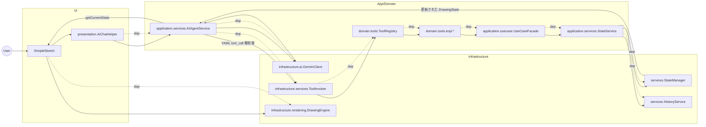
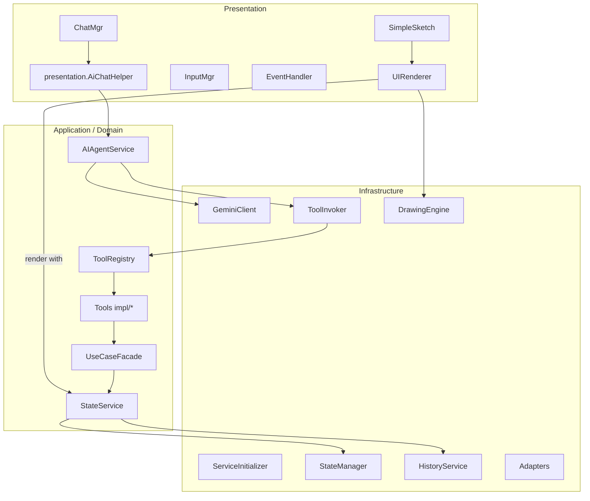

# Architecture Now — 現状アーキテクチャ概要（コード準拠版）

本書はリポジトリの最新実装を走査した「現状」の依存関係とデータフローを、実装実態ベースで図示・要約したものです（修正提案ではありません）。

> 差分メモ（2025-09-12）
> - ツール実装は `UseCaseFacade` 直接依存から `application.usecase.api.ToolUseCasePort` 依存に変更（依存逆転）。
> - `ToolRegistry` は自動で `ServiceInitializer` を呼ばず、`initializeWithPort(ToolUseCasePort)` による注入方式へ。
> - 注入は `AIAgentService` コンストラクタで実施（`ServiceInitializer.initialize()` → `ToolRegistry.initializeWithPort(ServiceInitializer.getUseCaseFacade())`）。

## Mermaid（レイヤと依存関係：現行コード準拠）

```mermaid
flowchart TB
  %% レイヤ分割
  subgraph UI[Presentation / UI]
    SimpleSketch[SimpleSketch]
    UIRenderer[presentation.SketchUIRenderer]
    InputMgr[presentation.InputManager]
    EventHandler[presentation.SketchEventHandler]
    ChatMgr[presentation.ChatManager]
  end

  subgraph APP[Application]
    AIAgentSvc[application.services.AIAgentService]
    UseCaseFacade[application.usecase.UseCaseFacade]
    StateService[application.services.StateService]
  end

  subgraph DOMAIN[Domain]
    DModels[domain.models / values]
    DTools[domain.tools (ToolRegistry, IAgentTool, impl/*)]
  end

  subgraph INFRA[Infrastructure]
    Gemini[infrastructure.ai.GeminiClient]
    ToolInvoker[infrastructure.services.ToolInvoker]
    DrawingEngine[infrastructure.rendering.DrawingEngine]
    ServiceInitializer[infrastructure.ServiceInitializer]
    Adapters[infrastructure.adapters (StateManagerAdapter, HistoryServiceAdapter)]
    Srv[services (StateManager, HistoryService, SessionManager, FileStateRepository)]
  end

  %% 依存関係（点線：コンパイル時）
  SimpleSketch -.-> AIAgentSvc
  SimpleSketch -.-> UIRenderer
  UIRenderer -.-> DrawingEngine

  AIAgentSvc -.-> Gemini
  AIAgentSvc -.-> ToolInvoker
  AIAgentSvc -.-> DTools

  ToolInvoker -.-> DTools
  DTools -.-> ServiceInitializer
  ServiceInitializer -.-> StateService
  ServiceInitializer -.-> UseCaseFacade
  ServiceInitializer -.-> Adapters
  Adapters -.-> Srv

  DrawingEngine -.-> DModels

  %% 凡例
  classDef note fill:#f8f8f8,stroke:#bbb,color:#333;
  Note1([Legend: dotted = dependency (compile-time), group = layer]):::note
```

ポイント:
- 現在は `ToolRegistry` 自身は `ServiceInitializer` を参照せず、外部（`AIAgentService`）から `ToolUseCasePort`（実体は `UseCaseFacade`）が注入されます（ドメイン→インフラの逆依存は解消）。
- UI は `AIAgentService` を介して AI（Gemini）とツール実行を呼び出し、描画は `DrawingEngine` で行います。

## ASCII（レイヤと依存関係：現行コード準拠）

```
+==================== Presentation / UI ====================+
| SimpleSketch                                             |
| presentation.SketchUIRenderer  -> infrastructure.rendering.DrawingEngine
| presentation.InputManager                                |
| presentation.SketchEventHandler                          |
| presentation.ChatManager                                 |
+==========================================================+
                           |
                           | calls / uses
                           v
+====================== Application =======================+
| application.services.AIAgentService                      |
|   - uses infrastructure.ai.GeminiClient                  |
|   - uses infrastructure.services.ToolInvoker             |
|   - on start:                                            |
|       ServiceInitializer.initialize()                    |
|       ToolRegistry.initializeWithPort(UseCaseFacade)     |
| application.usecase.UseCaseFacade                        |
|   - implements application.usecase.api.ToolUseCasePort   |
| application.services.StateService                        |
+==========================================================+
                           ^                 ^
                           |                 | implements port
                           |                 |
                           | uses            |
                           |                 |
                           v                 |
+======================== Domain ==========================+
| domain.tools.ToolRegistry (no infra call; port injected) |
| domain.tools.IAgentTool + impl/*                         |
|   - depend on ToolUseCasePort (not on UseCaseFacade)     |
| domain.models/*, domain.values/*                         |
+==========================================================+

+==================== Infrastructure ======================+
| infrastructure.ai.GeminiClient                           |
| infrastructure.services.ToolInvoker                       |
| infrastructure.rendering.DrawingEngine                    |
| infrastructure.ServiceInitializer                         |
| infrastructure.adapters.* (StateManagerAdapter, etc.)     |
| services.StateManager, services.HistoryService            |
+==========================================================+
```

## Mermaid（依存＋データフロー統合：現行フロー）



## ASCII（依存＋データフロー統合：現行フロー）

```
User
  |
  v
SimpleSketch  --(UI events/text)-->  ChatManager  --(prompt)-->  AIAgentService
                                                      |
                                                      | uses
                                                      v
                                      infrastructure.ai.GeminiClient
                                                      |
                                   (text / YAML tool_call)
                                                      v
AIAgentService --(validated tool_call)--> ToolInvoker --> ToolRegistry --> Tool impl (depends on ToolUseCasePort)
                                                                      |
                                                                      v
                                              UseCaseFacade (implements ToolUseCasePort)
                                                                      |
                                                                      v
                                                        StateService  --->  StateManager / HistoryService
                                                                      |
                                                                      | updated DrawingState
                                                                      v
                                                         AIAgentService.getCurrentState()
                                                                      |
                                                                      v
                                             presentation.SketchUIRenderer --> infrastructure.rendering.DrawingEngine
```

## Mermaid（コンポーネント構成図：現行の責務分担）



## 未接続/未使用コンポーネント（現状のギャップ）

- 未実装/未存在（旧ドキュメントにのみ登場）
  - `application.ApplicationController`, `application.CommandParser`, `application.CommandFactory`, `events.EventDispatcher`
  - `agent.*`（`AgentService`, `AIPromptIntegrator`, `DiffService` など）
  - `engine.YamlParser`
- 現状未使用/未配線 → 不要と判断し削除済み
  - `infrastructure.ServiceFactory`（参照なし → 削除済み）
  - `application.services.CommandExecutor`（空実装・参照なし → 削除済み）
  - `infrastructure.services.SessionManager`, `infrastructure.services.FileStateRepository`（現行UIフロー外 → 削除済み）
  - `domain.services.ISessionManager`, `domain.repositories.IStateRepository`（上記のため不要 → 削除済み）

備考:
- `ToolRegistry` → `ServiceInitializer` の依存により、ドメイン層からインフラ層への参照が発生しています（現状の設計上の現実）。

## データ/制御フロー（要約）

1) チャット入力〜AI応答〜ツール実行〜描画

```
User → SimpleSketch → AiChatHelper → AIAgentService
  → GeminiClient（テキスト生成）
  → 構造化YAML解析（tool_call の場合）
  → ToolInvoker → ToolRegistry → 各 Tool 実装 → UseCaseFacade → StateService → StateManager/HistoryService
  → AIAgentService.getCurrentState() 更新 → SketchUIRenderer/DrawingEngine で描画
```

2) Undo/Redo（StateService 経由）

```
UseCase 実行時に HistoryService が履歴を記録。必要に応じて StateService → HistoryService.undo/redo → StateManager.updateState → 描画更新。
```

## レイヤ対応（Clean Architecture 対応づけ：現状）

- Presentation（UI）
  - `com.example.SimpleSketch`, `com.example.presentation.*`（`SketchUIRenderer`, `InputManager`, `SketchEventHandler`, `ChatManager`, `AiChatHelper`）
- Application（アプリケーションサービス/ユースケース集約）
  - `com.example.application.services.AIAgentService`, `com.example.application.usecase.*`, `com.example.application.services.StateService`
- Domain（エンティティ/ドメインロジック）
  - `com.example.domain.models/*`, `com.example.domain.values/*`, `com.example.domain.tools/*`
- Infrastructure（技術詳細/外部I/O）
  - `com.example.infrastructure.ai.GeminiClient`, `com.example.infrastructure.services.*`（`ToolInvoker`, `StateManager`, `HistoryService`, `SessionManager`, `FileStateRepository`）
  - `com.example.infrastructure.adapters.*`（`StateManagerAdapter`, `HistoryServiceAdapter`）
  - `com.example.infrastructure.rendering.DrawingEngine`, `com.example.infrastructure.ServiceInitializer`

---

本ドキュメントはコードの現状に追随して更新されています。設計上の改善（例: ドメイン→インフラ依存の反転、セッション/永続化の UI 連携など）を行った際は、本書の更新も併せてお願いします。
